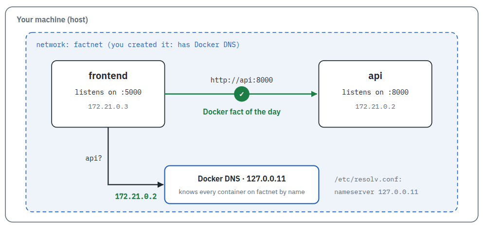

Create a network `factnet` and use it to connect both containers:

```
docker network create factnet
docker network connect factnet api
docker network connect factnet frontend
```{{exec}}




Refresh the page `localhost:8080` (or `curl localhost:8080`{{exec}}).

Can you talk directly to the `api`?

`curl localhost:8000/fact`{{exec}}

## Clean up

`docker rm -f api frontend`{{exec}}